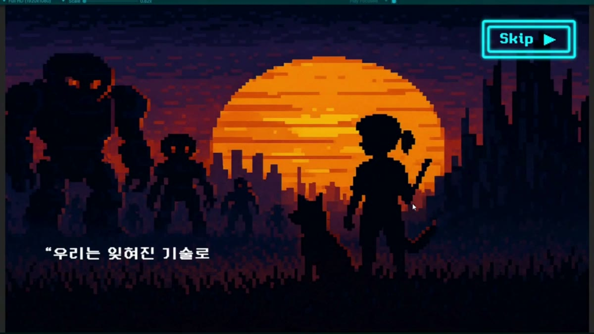
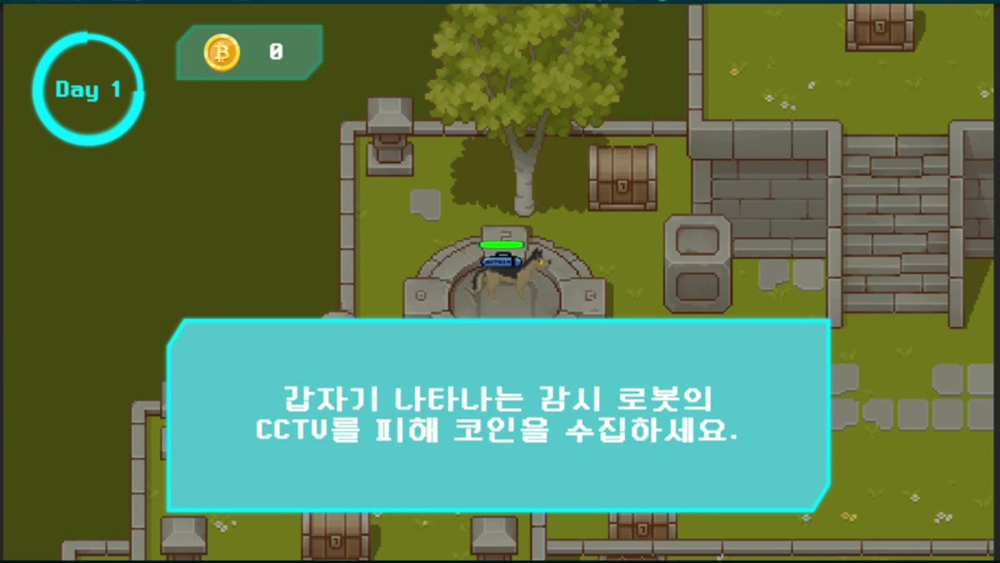
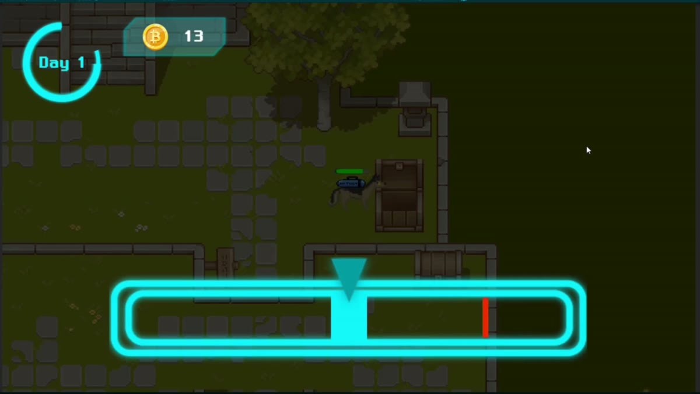
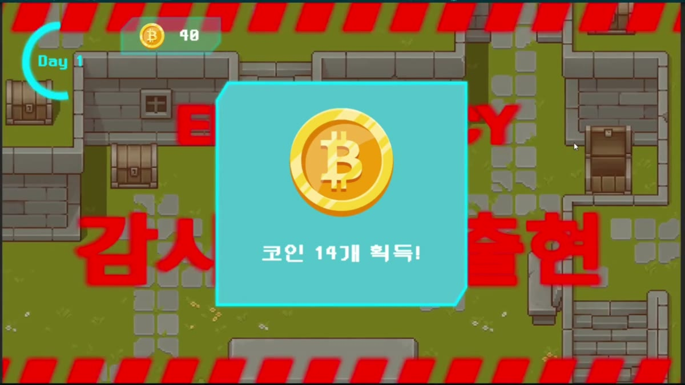
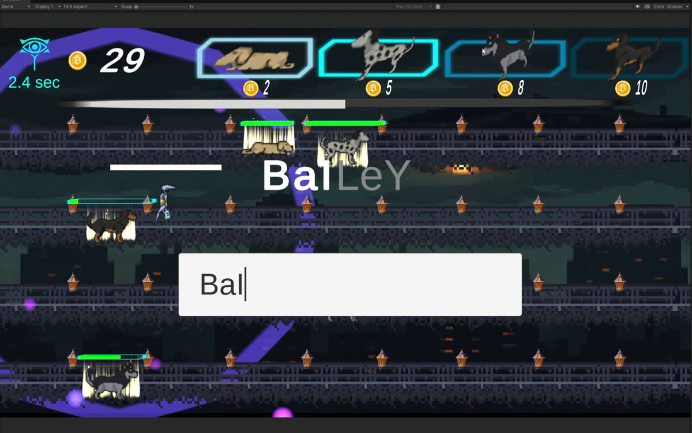
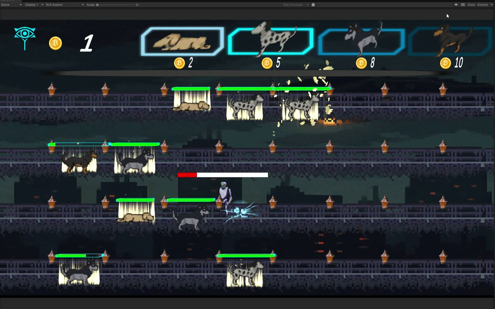
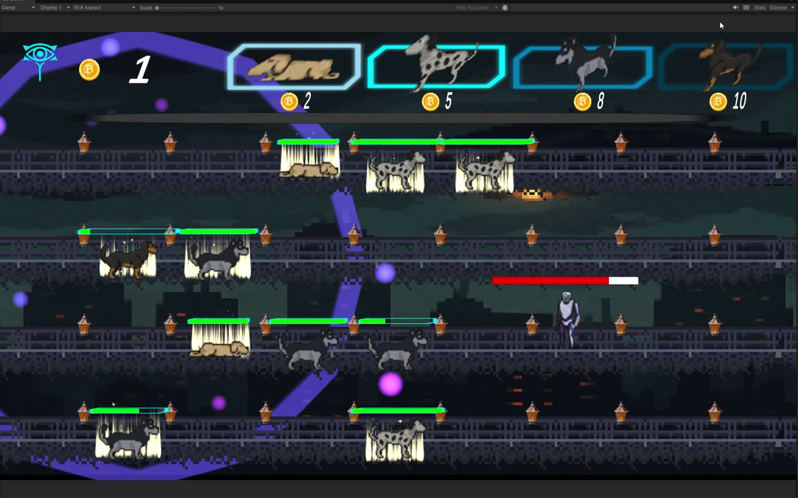

<p align="center"></p>

## ▶ 플레이 영상

https://github.com/user-attachments/assets/865e7215-6d7e-421f-b7aa-084842d85ec5

<p align="center">전체 플레이 · 오프닝 컷신 → 낮 탐색·상자 열기·감시 로봇 → 밤 타이핑 소환·배치·로봇 전투 · 6분 3초</p>

# 멍멍전선 2077

> Unity 2D 디펜스 게임 · 낮에는 자원 확보, 밤에는 강아지 부대로 방어선 사수
> 아주대학교 게임엔진프로그래밍(2025-1) 팀 프로젝트 · 4인 팀 · 2025.03 – 2025.06


## 한 줄 소개

낮에는 감시 로봇의 눈을 피해 상자를 열어 코인과 산소를 모으고, 밤에는 그 코인으로 강아지를 소환해 밀려오는 로봇을 막는 2D 디펜스 게임입니다.
낮의 탐색과 밤의 방어가 코인 하나로 이어져, 낮에 얼마나 모았는지가 밤에 세울 수 있는 강아지 부대를 정합니다.

## 게임 흐름

```
오프닝 컷신
   │
   ▼
┌─ 낮: 탐색 ─────────────────────────────┐      ┌─ 밤: 방어 ─────────────────────────────┐
│ 맵을 돌며 상자 앞에서 E 키              │      │ 강아지 선택 (코인 2 · 5 · 8 · 10)       │
│  → 타이밍 바 3단계를 맞히면 상자 열림   │ 코인 │  → 강아지 이름 문장을 5초 안에 타이핑   │
│  → 코인 · 산소 획득                     │ ───▶ │     성공: 체력·공격 1.3배 + 버프 이펙트 │
│ 감시 로봇 출현 → CCTV를 피해 버티기     │      │  → 타일 2칸 단위로 배치                 │
│ 열린 상자는 시간이 지나면 다시 생김     │      │ 로봇이 왼쪽으로 전진 ↔ 강아지 공격      │
└────────────────────────────────────────┘      │ 로봇이 방어선에 닿으면 배드 엔딩        │
                                                └────────────────────────────────────────┘
```

## 낮: 탐색

| 탐색 | 상자 열기 (타이밍 바) | 감시 로봇 출현 |
|---|---|---|
|  |  |  |

- 탑다운 맵을 돌아다니며 상자를 찾습니다. 상자 앞에서 E 키를 누르면 타이밍 바가 나오고, 움직이는 표시를 목표 구간에 3번 맞추면 상자가 열려 코인과 산소를 얻습니다. 단계가 오를수록 목표 구간이 좁아집니다.
- 탐색 중 갑자기 감시 로봇이 나타나면, 일정 시간 동안 로봇의 CCTV 감지 범위를 피해야 합니다.
- 열린 상자는 일정 시간이 지나면 다시 채워집니다. 화면 위에는 날짜와 코인, 산소가 표시됩니다.

## 밤: 방어

| 타이핑 소환 | 강아지 부대 전투 | 로봇 전진 |
|---|---|---|
|  |  |  |

- 낮에 모은 코인으로 강아지 4종 중 하나를 고르면, 그 강아지 이름이 들어간 문장이 나옵니다. 5초 안에 정확히 타이핑하면 체력과 공격이 1.3배인 강화 강아지가, 실패하거나 시간이 지나면 일반 강아지가 소환됩니다.
- 강아지는 타일 2칸 단위로 배치하고, 이미 놓인 자리에는 놓을 수 없습니다.
- 강아지마다 전투 방식이 다릅니다: 사거리 안 로봇을 찾아 쏘는 원거리, 주기적인 범위 피해, 5초마다 1.5초 무적 등.
- 로봇은 오른쪽에서 왼쪽으로 전진하며 강아지를 공격하고, 방어선(왼쪽 끝)에 닿으면 배드 엔딩입니다.

## 팀과 역할

| 파트 | 담당 |
|---|---|
| 낮 탐색 · 상자 · 타이밍 바 · CCTV 미니게임 · 낮밤 전환 · 자원 · 컷신 · HUD | 팀원 3명 |
| **밤 소환 · 전투 시스템** | **송재혁** |

### 내가 맡은 일 (송재혁)

- **타이핑 소환:** 강아지별 문장 목록에서 무작위 문장을 내고, 5초 타이머로 성공 여부를 판정해 강화 소환으로 연결했습니다. 기획 단계의 음성 인식 소환을 최종 구현에서 타이핑으로 바꿨습니다.
- **배치:** 마우스 위치를 타일맵 2칸 그룹으로 맞추고 중복 배치를 막았습니다.
- **강아지 전투:** HP바와 강화 효과, Raycast로 로봇을 찾는 원거리 투사체, 주기적 범위 피해, 주기적 무적을 강아지 타입별로 만들었습니다.
- **로봇:** 전진·공격·HP바·사망 처리와 방어선 도달 시 배드 엔딩을 만들었습니다.

`src/`에는 이 밤 파트에서 제가 작성한 스크립트 9개를 담았습니다(`DogSpawner.cs`는 팀원 코드와 일부 공동).

## 기술 스택

Unity 6 (6000.0.42f1) · C# · 2D Tilemap · Physics2D · TextMeshPro · 코루틴 기반 타이머·전투

## 이 저장소에 대해

소개용 저장소입니다. 팀 전체 프로젝트는 팀원 계정의 비공개 저장소에 있고, 유료 에셋(이펙트·텍스트 애니메이션 팩)이 포함되어 있어 공개하지 않습니다. 여기에는 게임 소개와 플레이 화면, 제가 작성한 밤 파트 스크립트만 담았습니다.
